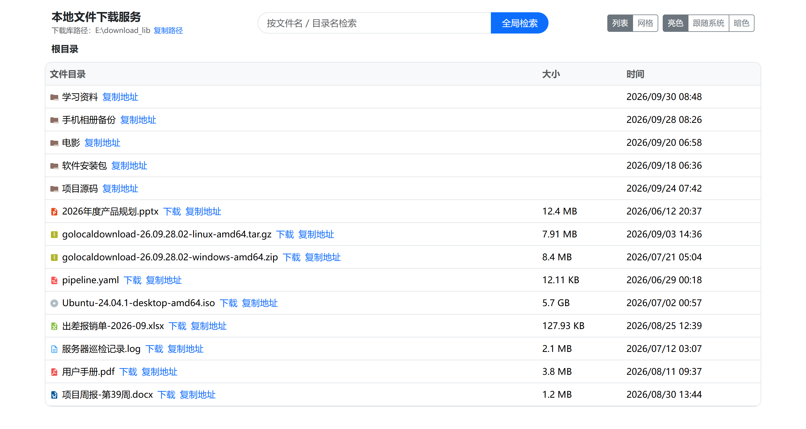
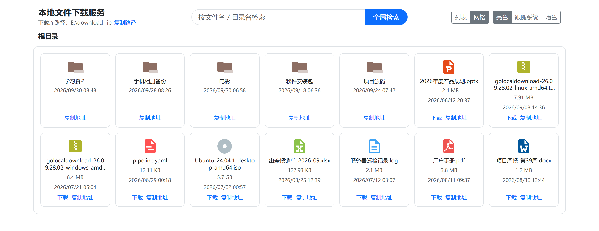
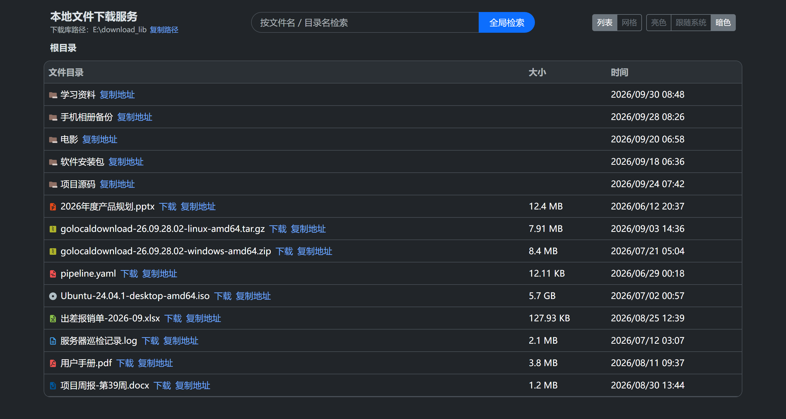
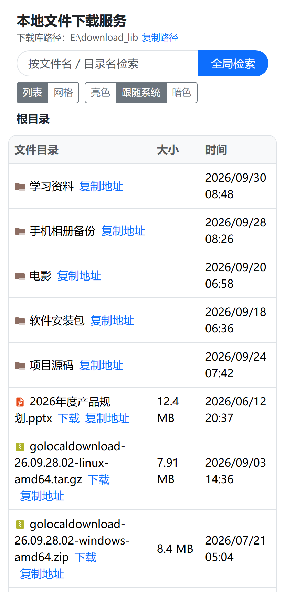
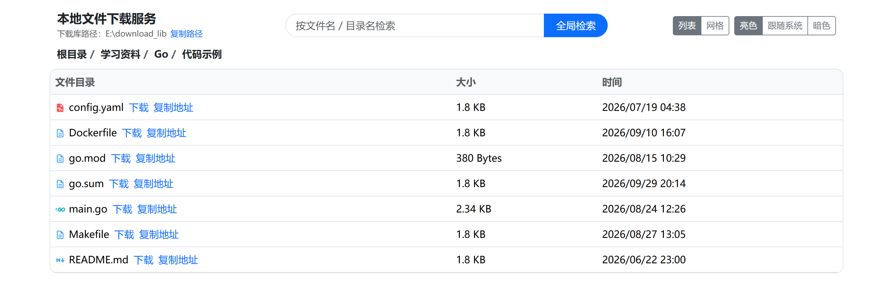
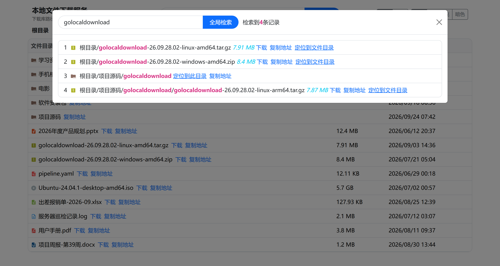
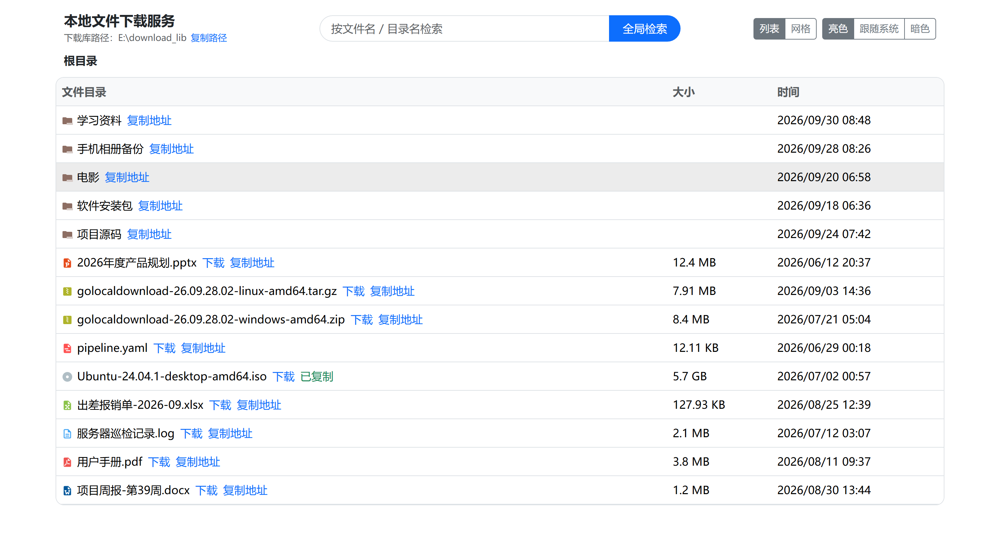

[简体中文](README.md) | **繁體中文** | [English](README.en.md)

# Golocaldownload · 本地檔案下載服務

[](https://github.com/kite88/golocaldownload/releases/latest)
[](LICENSE)

用 Go + Gin 寫的本地檔案下載服務：把伺服器上的某個目錄當作「下載庫」，瀏覽器裡就能瀏覽目錄、
按檔名全域性檢索、點選下載。頁面模板與靜態資源全部內嵌進二進位制，釋出出去就是一個可執行檔案，
配置也有內嵌預設值，**解壓即用**。

| 倉庫    | 地址                                       |
| ------- | ------------------------------------------ |
| GitHub  | https://github.com/kite88/golocaldownload  |
| GitCode | https://gitcode.com/kite88/golocaldownload |
| Gitee   | https://gitee.com/kite88/golocaldownload   |

## 介面預覽

> 截圖取自本機 `go run .` 的實際頁面：下載庫指向 `E:\download_lib`，標題下方顯示的就是這個目錄
> （在容器裡會顯示成宿主機上對映的那個目錄）。

| 列表檢視：目錄排在檔案前，帶大小與修改時間 | 網格檢視：按副檔名顯示圖示 |
| :--: | :--: |
|  |  |

| 暗色主題：亮色 / 跟隨系統 / 暗色三態可切換 | 窄屏：手機瀏覽器下自動改為縱向堆疊 |
| :--: | :--: |
|  |  |

## 功能

- **目錄瀏覽**：麵包屑逐級跳轉，目錄排在檔案前面，展示大小與修改時間。
- **按型別顯示圖示**：壓縮包 / 圖片 / 影片 / 音訊 / 文件 / 表格 / 程式碼等按副檔名顯示不同圖示
  （圖示取自 Material Icon Theme，MIT，見 `web/static/icon/material/LICENSE.txt`），未知副檔名回落到通用文件圖示。
- **全域性檢索**：按檔名做忽略大小寫的子串匹配，可一鍵定位到檔案所在目錄。
- **檔案下載**：中文、空格等非 ASCII 檔名按 RFC 5987 編碼，瀏覽器不會存成亂碼。
- **一鍵複製地址**：檔案複製出來的是可直接使用的絕對下載地址（瀏覽器、`wget`、下載工具都能直接吃），
  目錄複製的是定位到該目錄的頁面地址（按當前訪問方式生成，本機或區域網 IP），標題下方的「複製路徑」
  複製的是下載庫自身的絕對路徑（容器裡是宿主機上的對映目錄）；複製後連結會短暫顯示「已複製」。
- **主題切換**：亮色 / 跟隨系統 / 暗色三態，選擇記在瀏覽器本地；首幀就應用主題，暗色下不會閃白屏。
- **列表 / 網格兩種檢視**：列表適合看大小與時間，網格適合按圖示認內容（圖片、壓縮包等）；
  右上角一鍵切換，選擇同樣記在瀏覽器本地。兩套檢視共用同一份資料，切換不會重新請求介面。
- **越界防護**：列表、檢索、下載都只允許訪問下載庫之內的路徑，`../` 之類的目錄穿越會被直接拒絕。
- **單檔案交付**：頁面模板、靜態資源、配置模板全部內嵌，執行時不依賴任何外部檔案。
- **優雅退出**：`Ctrl+C` 或 `SIGTERM` 會等待在途下載收尾後再退出，不會掐斷大檔案傳輸。

## 功能演示

### 1. 目錄瀏覽與麵包屑

點目錄名進入下一級，麵包屑按層級鋪開，任意一級都能直接跳回去；目錄排在檔案前面，列表與網格兩套檢視
共用同一份資料，切換時只重繪、不重新請求介面。



### 2. 全域性檢索

按檔名 / 目錄名做忽略大小寫的子串匹配（最多 500 條），命中的檔名與路徑都會高亮；每條結果都能
直接「下載」「複製地址」，目錄還能「定位到此目錄」、檔案能「定位到檔案目錄」，一鍵跳到它所在的層級。



### 3. 下載與一鍵複製地址

「下載」走瀏覽器原生下載；「複製地址」複製出來的是可直接使用的絕對地址
（`http://<host>:9801/api/download?data=...`），粘到瀏覽器、`wget`、下載工具裡都能直接吃，
目錄複製的則是定位到該目錄的頁面地址；複製成功後連結會短暫變成綠色的「已複製」。



## 目錄結構

```text
.
├── main.go                 程式入口：裝配配置、路由、優雅退出
├── config/                 配置載入（內嵌 env.ini.<環境> 模板 + 外部 env.ini 覆蓋）
├── common/                 通用工具：目錄準備、路徑安全解析、體積格式化
├── handle/                 三個介面的實現：列表 / 檢索 / 下載
├── router/                 路由裝配：頁面、靜態資源、API 分組
├── test/                   程序內路由整合測試
├── web/
│   ├── view/index.html     頁面模板（內嵌）
│   └── static/             Bootstrap / jQuery / 圖示 / 前端指令碼（內嵌）
├── tools/pack/             歸檔打包器：讓 zip 與 tar.gz 可復現（構建指令碼呼叫）
├── start.bat / start.sh    啟動指令碼：與可執行檔案同級，雙擊 / ./ 即可執行（會打進歸檔）
├── build.ps1 / build.sh    交叉編譯全部平臺
├── Dockerfile              兩階段構建的最小映象
└── .github/workflows/      發版流程：檢查/測試 → 交叉編譯發 Release → 推多架構映象
```

## 快速開始

需要 Go 1.23 及以上。

```bash
# 開發模式直接跑
go run .

# 或編譯後執行
go build -o golocaldownload . && ./golocaldownload
```

啟動後會列印版本、配置來源、下載庫目錄與可訪問地址，訪問其中任意一個地址即可：

```text
2026-09-28 10:00:00 golocaldownload dev（debug）
配置來源: config/env.ini
下載庫目錄: E:\download_lib
本機訪問: http://127.0.0.1:9801
區域網訪問: http://192.168.1.10:9801
```

把要對外提供的檔案丟進「下載庫目錄」，重新整理頁面就能看到。

### 命令列引數

| 引數 | 預設值 | 說明 |
| --- | --- | --- |
| `-config` | 空 | 指定外部配置檔案（ini）路徑；留空時按下面的優先順序自動查詢 |
| `-version` | `false` | 列印版本號後退出 |

### 配置項

配置檔案是 INI 格式（`config/env.ini.<環境>` 是倉庫裡的模板）：

| 配置項 | 預設值 | 說明 |
| --- | --- | --- |
| `env_mode` | `release` | 執行模式：`debug` / `release` / `test`，取值非法時按 `release` 處理 |
| `download_lib_path` | `download_lib` | 下載庫目錄；支援相對與絕對路徑，多級目錄會自動建立；留空表示用程式當前工作目錄 |
| `display_lib_path` | 空 | 頁面上展示的下載庫路徑；留空時自動識別容器對映的宿主機目錄（見「掛載路徑」小節），識別不到就用真實路徑 |
| `server.protocol` | `http` | 僅用於啟動日誌裡拼出訪問地址，不改變實際監聽方式 |
| `server.http_port` | `9801` | 監聽埠 |

配置來源按優先順序從高到低：

1. `-config` 引數 / `GLD_CONFIG` 環境變數指定的檔案（指定了就必須存在）；
2. 工作目錄下的 `env.ini`；
3. 工作目錄下的 `config/env.ini`；
4. 二進位制內嵌的 `env.ini.<GLD_ENV>`（`GLD_ENV` 預設 `release`）；
5. 二進位制內嵌的 `env.ini.release`。

> 相比舊版，`download_lib_path` 現在允許寫 `./a/b` 這類多級路徑（會逐級建立），
> 並且**不再需要**為了編譯而把 `env.ini.local` 改名成 `env.ini`：預設走內嵌模板，
> 原始碼 clone 下來直接 `go build` 即可。

## 交叉編譯

```powershell
.\build.ps1                      # Windows（PowerShell 5.1 / 7）
.\build.ps1 -OutDir D:\tmp\dist  # 換輸出目錄
```

```bash
./build.sh                       # macOS / Linux
./build.sh -o /tmp/gld-dist      # 換輸出目錄
```

目標矩陣寫在兩個指令碼的頂部，增刪一行即可。預設覆蓋：

| 系統 | 架構 |
| --- | --- |
| Windows | amd64 / arm64 / 386 |
| Linux | amd64 / arm64 / 386 / arm(v7) / ppc64le / s390x / riscv64 / loong64 |
| macOS | amd64 / arm64 |
| FreeBSD | amd64 / arm64 |

兩個指令碼跑同一份目標矩陣、呼叫同一個打包工具，**產物逐位元組一致**（校驗和相同），預設輸出到
`dist/`（已被 `.gitignore` 忽略）。按業界慣例，Windows 出 zip，其餘平臺出 `.tar.gz`
（zip 不儲存 Unix 執行位，tar.gz 才能讓 Linux / macOS 使用者解壓後直接執行）：

```text
dist/
├── golocaldownload-windows-amd64.zip    →  golocaldownload.exe + start.bat
├── golocaldownload-linux-arm64.tar.gz   →  golocaldownload + start.sh（都是 0755 執行位）
├── ……                                    （共 15 個平臺）
├── golocaldownload(.exe)                ← 本機平臺的未壓縮版，本機自用、不釋出
└── checksums.txt                        ← 15 個歸檔的 SHA256（LF 換行，可 sha256sum -c）
```

歸檔裡的可執行檔案帶版本號（取自 `git describe`，非 git 環境為 `dev`），`golocaldownload -version` 可查。
每個歸檔裡還多帶一份啟動指令碼（Windows 是 `start.bat`，其餘平臺是 `start.sh`）：解壓後雙擊 / 執行它就能
起來，引數原樣透傳給程式，例如 `start.bat -config .\env.ini`、`./start.sh -config /etc/gld/env.ini`。

> 歸檔由 `tools/pack` 生成，而不是呼叫系統 `tar` / `zip`：Windows 自帶的 `tar.exe`（精簡版
> bsdtar）不讀 Unix 許可權位、也不支援 `--mode`，打出來的包在 Linux 上解壓是 644、跑不起來；
> `zip(1)` 在 macOS / Linux 上也不是必然存在，而且各實現寫出的位元組不一致。`pack` 用 Go 標準庫
> 顯式寫入 0755，並把時間戳固定下來，所以同原始碼無論在哪個平臺、用哪個指令碼構建，產物和校驗和都可復現；
> 啟動指令碼這類附加檔案用 `-add`（`歸檔內檔名=原始檔路徑`，可重複）寫進同一個歸檔。

### 發版

推 `v*` 或日期式標籤（如 `26.09.28.03`，沿用 `YY.MM.DD.NN` 習慣）即可，workflow（`.github/workflows/release.yml`）
會自動做完三件事：

1. **檢查與測試**：`go vet ./...`、`go test ./...`；
2. **發 Release**：交叉編譯全部平臺，用 `sha256sum -c checksums.txt` 自檢產物，再建立 GitHub Release；
3. **推映象**：構建 linux/amd64 + linux/arm64 多架構映象，推到 Docker Hub 與阿里雲容器映象服務。

```bash
git tag 26.09.28.03 && git push origin 26.09.28.03
```

任一步失敗都不會發版；標籤名含 `-`（如 `26.09.28.03-rc1`）會被標記為 prerelease，並且
**不會覆蓋映象的 `latest` 標籤**。

#### 映象推送需要配置 4 個 Secrets

倉庫 → **Settings → Secrets and variables → Actions**（直達
`https://github.com/kite88/golocaldownload/settings/secrets/actions`）：

| Secret | 值從哪裡來 |
| --- | --- |
| `DOCKERHUB_USERNAME` | Docker Hub 的**登入使用者名稱**（不是顯示名、不是郵箱） |
| `DOCKERHUB_TOKEN` | Docker Hub **Access Token**，許可權選 **Repo Read & Write**；密碼登入已被 Docker Hub 棄用 |
| `ALIYUN_REGISTRY_USERNAME` | 阿里雲 ACR 控制檯「訪問憑證」頁顯示的登入使用者名稱 |
| `ALIYUN_REGISTRY_PASSWORD` | 同頁設定的 **Registry 固定密碼**（不是阿里雲賬號密碼，也不是 AccessKey） |

兩個倉庫是**獨立開關**：只配一組也能用，缺的那組只在日誌裡打一條 `::notice::` 跳過；
兩組都沒配時映象 job 直接跳過並給出告警，不影響 Release 的建立。

映象地址寫在 workflow 的 `env:` 裡，換賬號 / 地域時改這兩行即可：

```yaml
ALIYUN_REGISTRY: registry.cn-shenzhen.aliyuncs.com
ALIYUN_IMAGE: registry.cn-shenzhen.aliyuncs.com/tutudev99/golocaldownload
```

> 映象構建**顯式關閉了 `provenance` / `sbom`**：阿里雲 ACR 個人版不認 BuildKit 生成的證明清單
> （`application/vnd.oci.empty.v1+json`），開著會直接 `denied: unknown manifest class`，
> 整包推不上去。要恢復的話得拆成兩次構建分別推送兩個倉庫。

## 部署

> 怎麼選：改程式碼 / 長期維護用**方式一**；只想跑程式用**方式二**；有 Docker 環境用**方式三**（本地構建）
> 或**方式四**（compose）；只想拉現成映象用**方式五**（Docker Hub）或**方式六**（阿里雲）。

### 掛載路徑怎麼寫（Docker 各方式通用）

Docker 各方式裡的 `-v <宿主機目錄>:/root/download_lib`，**右邊必須固定寫 `/root/download_lib`**
（映象內嵌配置裡的下載庫是相對路徑，基於容器工作目錄 `/root/`）；左邊按宿主機系統填：

| 宿主機 | 左邊的寫法 | 檔案實際位置 |
| --- | --- | --- |
| Linux | `-v /home/download_lib:/root/download_lib` | `/home/download_lib` |
| Windows + Docker Desktop | `-v D:/download_lib:/root/download_lib` | `D:\download_lib`（資源管理器裡可見） |
| macOS + Docker Desktop | `-v /Users/你的使用者名稱/download_lib:/root/download_lib` | 該目錄 |

Windows 上另外兩個坑：

- **別用 Linux 風格路徑**。`-v /home/download_lib:...` 會被當成 Docker Desktop 的 WSL2 虛擬機器**內部**路徑：
  容器照樣能跑，但資料不在 Windows 上、資源管理器看不到，Docker Desktop「Reset to factory defaults」
  時還會一起丟掉。要放 Windows 目錄就用帶磁碟機代號的路徑，**正斜槓最穩**。
- **Git Bash 會改寫路徑**。MSYS 會把 `/home/download_lib` 轉成 `<Git 安裝目錄>/home/download_lib`，
  需要寫成 `//home/download_lib` 或加 `MSYS_NO_PATHCONV=1`；直接用 `D:/download_lib` 也能繞開。

頁面上的「下載庫路徑」顯示的是 **宿主機上的目錄**，不是容器內路徑：程式啟動時讀
`/proc/self/mountinfo`，按「掛載點是下載庫字首且最長」找到那條 bind mount 記錄，用它的源目錄
當展示路徑（Windows 的 Docker Desktop 還會從超級選項 `path=C:\` 裡把磁碟機代號補回來）。用命名卷、
或實在識別不出來時回落顯示容器內真實路徑；想固定成某個值就配 `display_lib_path`。
啟動日誌裡兩者都會列印，便於對照：

```text
下載庫目錄: /root/download_lib
宿主機目錄: D:\download_lib
```

目錄不存在會自動建立（Docker 建宿主機目錄，程式啟動時 `MkdirAll` 兜底）。掛載是否生效一驗便知：

```bash
docker exec <容器名> ls -l /root/download_lib   # 容器內看到的
dir D:\download_lib                             # Windows 宿主機上看到的，兩者應一致
```

### 方式一：本地原始碼部署、二次開發

要改程式碼、想跑最新版，或者單純不想用容器時選這個。前置條件只有 **Go 1.23 及以上**。

**1. 克隆程式碼**

```bash
git clone https://github.com/kite88/golocaldownload.git
cd golocaldownload
```

> 上面倉庫表裡的 GitCode / Gitee 是映象站，靠平臺側的 Pull 映象同步、可能滯後；
> 要最新程式碼請以 GitHub 為準（預設分支 `main`）。

**2. 編譯**

```bash
go build -o golocaldownload .          # Linux / macOS
```

```powershell
go build -o golocaldownload.exe .      # Windows（PowerShell）
```

產物是**單個可執行檔案**：頁面模板、靜態資源、配置模板都已內嵌，拷到同架構的機器上就能直接跑。
預設不帶版本號（`-version` 顯示 `dev`），想帶上就自己加引數：

```bash
go build -trimpath -ldflags "-X main.version=26.09.28.02" -o golocaldownload .
```

**3. 啟動**

```bash
./golocaldownload                      # Linux / macOS
```

```powershell
.\golocaldownload.exe                  # Windows
```

開發時更省事的是 `go run .`（編譯到臨時目錄後立刻執行，不產檔案，改完程式碼重跑即可）。
預設監聽 `9801`，下載庫是**執行目錄下的 `download_lib/`**（不存在會自動建立）：把檔案丟進去、
重新整理頁面就能看到。啟動日誌會列印版本、配置來源、下載庫目錄與實際可訪問地址（本機 + 區域網）；
`Ctrl+C` 會等在途下載收尾後再退出。

編譯產物就落在倉庫根目錄，旁邊的 `start.bat` / `start.sh` 可以直接用（雙擊 / `./start.sh`），
用法與歸檔裡的那份一致。

**4. 改配置**

四種做法，挑順手的（優先順序見上面「配置來源」）：

- **① 複製模板**：複製成 `config/env.ini`，該檔案已被 `.gitignore` 忽略，改了不會汙染倉庫；
- **② `-config` 指定**：直接指向模板檔案，倉庫裡一個檔案都不動；
- **③ `GLD_ENV` 選內嵌模板**：取值為 `debug` / `local` / `release` / `test`；
- **④ `GLD_CONFIG` 環境變數**：與 `-config` 等價，適合容器、systemd 這類傳不了命令列引數的場景。

**Linux / macOS**

```bash
cp config/env.ini.local config/env.ini    # ①
go run . -config config/env.ini.local     # ②
GLD_ENV=local go run .                    # ③

GLD_CONFIG=/etc/golocaldownload/env.ini go run .   # ④
```

**Windows（PowerShell）**

```powershell
Copy-Item config\env.ini.local config\env.ini      # ①
go run . -config config\env.ini.local              # ②
$env:GLD_ENV = 'local'; go run .                   # ③

$env:GLD_CONFIG = 'D:\gld\env.ini'; go run .       # ④
```

> 已經編譯過就不必用 `go run .`，換成 `./golocaldownload`（Windows 為 `.\golocaldownload.exe`）即可；
> 用 `cmd.exe` 時環境變數那兩條要寫成 `set GLD_ENV=local`，並且必須在**同一個視窗**裡設定後再執行命令。

**5. 改程式碼後注意**

- `web/` 下的頁面與靜態資源是 `//go:embed` 打進二進位制的，**改完必須重新 `go build` 或重啟
  `go run .`**，只重新整理瀏覽器不會生效；
- 改完請跑一遍 `go test ./...`（`test/router_test.go` 裡的越界用例是安全迴歸測試），
  詳見下面的「開發」小節。

要一次性拿到全部平臺的壓縮包，用 `./build.sh` 或 `.\build.ps1`（見上面「交叉編譯」）。

### 方式二：本地主機執行可執行檔案

從 [Releases](https://github.com/kite88/golocaldownload/releases/latest) 下載對應平臺的壓縮包
（Windows 選 `.zip`，Linux / macOS / FreeBSD 選 `.tar.gz`），解壓後：

- **Windows**：雙擊 `start.bat`（等價於直接跑 `golocaldownload.exe`）。程式退出後視窗會停住顯示
  退出碼，按任意鍵關閉；在別的指令碼里呼叫可先設 `GLD_NO_PAUSE=1` 跳過這一步。
- **Linux / macOS / FreeBSD**：執行 `./start.sh`（與可執行檔案同目錄，執行位在歸檔裡已經帶好）。

兩個指令碼都只是「前臺啟動 + 引數透傳」，想直接執行可執行檔案也一樣：`start.bat -config .\env.ini`
與 `golocaldownload.exe -config .\env.ini` 等價。需要換埠或下載庫目錄，在同目錄放一份 `env.ini`
即可（模板見 `config/env.ini.*`）。

### 方式三：Docker 部署（本地構建映象）

第一步，構建映象（三個平臺同一條命令）：

```bash
docker build -t golocaldownload:latest .
```

第二步，按你的宿主機系統選一條執行命令。**三條命令只有 `-v` 左邊那段（宿主機目錄）不同**，右邊必須固定寫 `/root/download_lib`：

**Linux**

```bash
docker run -p 9801:9801 -v /home/download_lib:/root/download_lib --restart always --name golocaldownload-app -d golocaldownload:latest
```

**Windows（Docker Desktop）**

```powershell
docker run -p 9801:9801 -v D:/download_lib:/root/download_lib --restart always --name golocaldownload-app -d golocaldownload:latest
```

**macOS（Docker Desktop）**

```bash
docker run -p 9801:9801 -v /Users/你的使用者名稱/download_lib:/root/download_lib --restart always --name golocaldownload-app -d golocaldownload:latest
```

引數說明：

- `-p 9801:9801`：宿主機 9801 埠 → 容器 9801 埠；
- `-v <宿主機目錄>:/root/download_lib`：下載庫掛載，細節與兩個 Windows 坑見上面「掛載路徑」小節；
- `--restart always`：容器退出後自動重啟；`-d`：後臺執行。

構建時可以順帶注入版本號（隻影響容器內 `golocaldownload -version` 的輸出）：

```bash
docker build --build-arg GLD_VERSION=26.09.28.02 -t golocaldownload:latest .
```

### 方式四：docker-compose 部署

```bash
docker compose up -d      # 舊版 docker-compose 命令為 docker-compose up -d
```

埠與下載庫目錄都在 `docker-compose.yml` 裡改。預設寫的是 `/home/download_lib`（Linux 主機寫法），
**Windows 上要換成帶磁碟機代號的路徑**，例如 `D:/download_lib:/root/download_lib`。

### 方式五：拉取 Docker Hub 上的現成映象

```bash
docker pull tutudev99/golocaldownload:latest
docker run -p 9801:9801 --name golocaldownload -v /home/download_lib:/root/download_lib --restart always -d tutudev99/golocaldownload:latest
```

### 方式六：拉取阿里雲容器映象服務上的現成映象

```bash
docker pull registry.cn-shenzhen.aliyuncs.com/tutudev99/golocaldownload:latest
docker run -p 9801:9801 --name golocaldownload -v /home/download_lib:/root/download_lib --restart always -d registry.cn-shenzhen.aliyuncs.com/tutudev99/golocaldownload:latest
```

> Windows / macOS 宿主機把 `-v` 左邊換成自己的目錄（見上面「掛載路徑」小節）。
>
> 兩個倉庫都由發版流程自動推送兩份標籤：`latest` 與對應版本號（如 `26.09.28.02`），映象同時覆蓋
> linux/amd64 與 linux/arm64，ARM 伺服器與 Apple Silicon 可直接跑。需要固定版本、避免 `latest`
> 隨發版漂移時，把命令裡的 `:latest` 換成具體版本號即可。

## 介面

| 方法與路徑 | 引數 | 說明 |
| --- | --- | --- |
| `GET /` | - | 頁面 |
| `GET /api/list` | `path`（相對下載庫的路徑，如 `/sub`，留空為根目錄） | 列出目錄內容 |
| `POST /api/search` | 表單 `keyword` | 按檔名檢索，最多返回 500 條 |
| `GET /api/download` | `data`（檔案路徑的 base64url 編碼） | 下載檔案 |

出錯時返回對應的狀態碼與 `{"error": "..."}`：路徑越界 `400` / `403`，目標不存在 `404`，
目錄不可讀 `403`，其他內部錯誤 `500`。

`GET /api/list` 的響應：

```json
{
  "root_dir": "/data/download_lib",
  "absolute_dir": "/data/download_lib/sub",
  "relative_dirs": [{"": ""}, {"sub": "/sub"}],
  "list": [
    {
      "name": "a.zip",
      "is_dir": false,
      "size": 1.5,
      "size_unit": "MB",
      "mod_time": "2026/09/28 10:00",
      "parent_path": "/sub",
      "path": "/sub/a.zip",
      "pathname_key": "L2RhdGEvZG93bmxvYWRfbGliL3N1Yi9hLnppcA=="
    }
  ]
}
```

## 實現要點

- **所有請求路徑都經過越界校驗**：舊實現把 `rootDir` 與 `path` 直接字串拼接
  （`rootDir + path`），傳 `?path=/../../etc/passwd` 就能列出下載庫之外的目錄，
  下載介面更是可以讀取服務端任意檔案。現在統一走 `common.SafeJoin`：先拒絕含 NUL 的路徑，
  再統一分隔符、清掉首部斜槓，最後用 `filepath.Rel` 確認結果沒有逃出根目錄；
  下載介面還會額外校驗「絕對路徑也必須落在根目錄之內」。
- **路由常開 `Recovery`**：舊實現在 release 模式用 `gin.New()`（既沒有 Logger 也沒有
  Recovery），而 handler 裡用 `log.Panicln` 處理錯誤，一次「目錄不存在」就能讓程序直接退出。
  現在 handler 只返回狀態碼與錯誤資訊，引擎在任何模式下都掛著 `Recovery`。
- **配置內嵌四份環境模板**：舊實現只 `//go:embed env.ini`，而 `env.ini` 被 `.gitignore`
  排除、倉庫裡並不存在，clone 下來 `go build` 會報 `pattern env.ini: no matching files found`，
  必須先手工改名。現在內嵌 `env.ini.debug / .local / .release / .test`，用 `GLD_ENV` 選擇，
  外部 `env.ini` 依然可以覆蓋，編譯開箱即用。
- **配置訪問帶預設值且不會 panic**：`env_mode` 取值非法時回落到 `release`，避免 `gin.SetMode`
  直接 panic；`GetInt` / `GetBool` / `GetDuration` 在配置缺失或寫錯時返回預設值。
- **下載檔名按 RFC 5987 編碼**：用標準庫 `mime.FormatMediaType` 生成 `Content-Disposition`，
  中文檔名不再亂碼。
- **檢索用 `filepath.WalkDir` 並限制條數**：`WalkDir` 不做多餘的 `lstat`、不跟隨符號連結；
  單個條目讀不到時跳過，不影響整體檢索；返回上限 500 條，避免一次檢索把響應體撐爆。
- **目錄排在檔案前面**：服務端排好序再返回，前端不用再排一遍。
- **靜態資源長快取**：頁面、圖示隨二進位制釋出，`Cache-Control: public, max-age=86400`；
  另外把根路徑的 `/favicon.ico` 也指向內嵌圖示。
- **優雅退出**：`signal.NotifyContext` + `http.Server.Shutdown`，只限制讀請求頭超時，
  下載大檔案時不會被寫超時掐斷。
- **根目錄顯式注入**：不再用 `GLD_download_lib_path` 環境變數在包之間隱式傳遞，
  `handle.New(root, displayRoot)` 讓介面天然可測——`test/` 裡用 `httptest` 在程序內跑真實路由，
  覆蓋了列表、檢索、下載、越界拒絕與 404 等場景。
- **容器裡顯示宿主機目錄**：容器內看不到宿主機的目錄結構，但每次 bind mount 都會在
  `/proc/self/mountinfo` 裡留一行，第 4 個欄位就是宿主機側的路徑。於是按「掛載點是下載庫字首
  且最長」取那條記錄，再把庫相對掛載點的部分拼上去（Windows 的 Docker Desktop 走 9p/drvfs，
  該欄位沒有磁碟機代號，需從超級選項 `aname=drvfs;path=C:\` 裡補回）。命名卷（掛載根為 `/`）、
  非容器環境等推斷不出來時，回落顯示容器內真實路徑，或用 `display_lib_path` 直接指定。
- **發版與映象解耦、且可重跑**：映象推送是獨立 job，跑在 Release 之後，推映象失敗不影響已發好的
  Release；兩個倉庫的憑據各自獨立開關，缺一組只跳過一組。Release 建立做成了冪等（已存在則
  `gh release upload --clobber` 覆蓋同名產物），否則映象失敗後重跑會先卡在「Release 已存在」上。

## 已知侷限

1. **沒有鑑權**：任何能訪問到埠的人都能瀏覽與下載下載庫裡的全部內容，預設只適合本機或內網使用。
2. **沒有 HTTPS**：`server.protocol` 隻影響啟動日誌裡列印的地址，真正的 TLS 需要由前置
   Nginx / Caddy 之類的反向代理終結。
3. **檢索是全量遍歷**：每次請求都會 `WalkDir` 一遍下載庫，沒建索引；下載庫特別大時會偏慢。
4. **只支援一個下載庫根目錄**，不支援多目錄對映，也沒有上傳、刪除、重新命名等寫操作。
5. **沒有斷點續傳與限速**：下載走 `gin.Context.File`，由標準庫 `http.ServeContent` 處理
   Range 請求，但沒有做併發數限制與限速，大檔案高併發時容易把頻寬打滿。
6. **前端仍是 jQuery + 字串拼 HTML**（已做轉義），沒有做前後端分離與構建鏈路。
7. **Docker 映象只覆蓋 linux/amd64 與 linux/arm64**（GitHub Release 裡則是 15 個平臺的二進位制）；
   32 位 x86 或其它架構請在宿主機上直接跑二進位制，或用方式三自行構建。

## 開發

```bash
go vet ./...    # 靜態檢查
go test ./...   # 單元測試 + 程序內路由整合測試
```

改動介面或路徑處理邏輯後，請務必跑一遍 `test/router_test.go`，其中的越界用例是安全迴歸測試。

## 許可證

[MIT](LICENSE)
